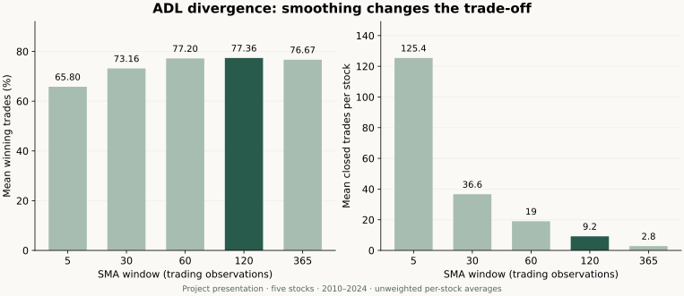

# ADL Divergence Trading Strategy

Chau Nguyen · MGMT 41310: Financial Modeling · Purdue University · March–May 2025

Team: Aochuan Shen, Aurelio Ji, Chau (Cyrus) Nguyen, John Stutzman and Nicholas Clem. The team presented the project on April 23, 2025.

## Research question
Can disagreement between smoothed price changes and the Accumulation/Distribution Line help define trading signals, and how do smoothing windows and stock selection affect backtest performance?

The project implements ADL from scratch as a reusable R function, tests a price–volume divergence strategy with `quantstrat`, and compares moving-average windows and portfolio composition using win rates and risk-adjusted trade statistics.

## Data and strategy
The executable analysis uses **KO, NVDA, AMZN, IBM and GOOG**, with daily Yahoo Finance prices from January 1, 2010 to January 1, 2025 (exclusive). `data/download_prices.R` retrieves and caches the data; no manually downloaded dataset is required.

1. Compute the money-flow multiplier `((Close−Low)−(High−Close))/(High−Low)`, multiply by volume, and cumulatively sum it to obtain ADL. Bars with zero high–low range contribute zero.
2. Smooth adjusted close and ADL with simple moving averages. Compute the one-observation percentage change of each smoothed series.
3. Enter long when the smoothed price change is negative and the smoothed ADL change is positive; exit when the signs reverse. Signals trigger when the divergence condition first becomes true.
4. Use market orders at the next available opening price, adding 1,000 shares per entry and closing all shares on an exit. Initial account equity is $1,000,000. The backtest uses gross trading P&L.
5. Compare windows of **5, 30, 60, 120 and 365 trading observations**, using the same backtest period. The selected source-code configuration uses 120 observations.

## Project results
The following table comes from the team's presentation. Values are **unweighted means of per-stock statistics**, not a pooled trade win rate or a portfolio Sharpe ratio.

| SMA observations | Mean winning trades | Mean trades per stock | Mean `tradeStats` Ann.Sharpe |
|---:|---:|---:|---:|
| 5 | 65.80% | 125.4 | 1.97 |
| 30 | 73.16% | 36.6 | 4.86 |
| 60 | 77.20% | 19.0 | 5.70 |
| 120 | 77.364% | 9.2 | 10.53 |
| 365 | 76.67% | 2.8 | 6.05 |

The 120-observation configuration improves the reported mean win rate and risk-adjusted trade statistic relative to the 5-observation configuration, while producing fewer trades. The 365-observation setting has a higher mean profit-to-maximum-drawdown ratio.



The presentation also compares the five-stock configuration with a 40-stock configuration at 120 observations: mean winning-trade percentages are 77.364% and 61.18%, respectively. The runnable configuration in this repository is the five-stock analysis; the broader comparison is retained in `results/project-variant-comparison.csv` as a team-reported result.

`results/project-five-stock-statistics.csv` contains the saved five-stock output table from the project HTML. `results/project-variant-comparison.csv` transcribes the presentation's window and stock-universe tables. Their source labels distinguish these project tables from outputs produced by a local run.

The reported `Ann.Sharpe` uses `blotter::tradeStats()` with `inclZeroDays = FALSE`. It annualizes the ratio of mean daily trading P&L to its standard deviation on nonzero-P&L days. The runner exports this statistic and the Sharpe ratio of daily account returns separately.

## Run
From the repository root:

```sh
Rscript setup.R
Rscript tests/test_indicators.R
Rscript run_analysis.R
Rscript run_analysis.R 5,30,60,120,365
```

The default runs the 120-observation, five-stock strategy. The second analysis command runs all five documented windows. An explicit symbol list and output folder are supported:

```sh
Rscript run_analysis.R 120 KO,NVDA,AMZN,IBM,GOOG outputs/five-stocks
```

The runner writes trade statistics, transactions, account equity, distinct risk-adjusted statistics and session information under `outputs/`. Market-data caches and generated run outputs are excluded from Git. Figure generation uses `python -m pip install -r requirements-figures.txt` followed by `python plot.py`.

## Implementation
- `src/indicators.R`: reusable ADL and smoothing functions.
- `src/strategy.R`: indicators, divergence signals, execution rules and backtest exports.
- `data/download_prices.R`: market-data acquisition and schema validation.
- `tests/test_indicators.R`: manual ADL example, independent indicator comparison, temporal smoothing and signal checks.
- `results/`: project comparison tables with explicit metric definitions.

[Portfolio case study](https://thesuncyrus.github.io/adl.html) · [quantstrat](https://github.com/braverock/quantstrat) · [blotter tradeStats definition](https://github.com/braverock/blotter/blob/dddb448f7a5d6eb63dfbe421ba80779e820a3601/R/tradeStats.R)
